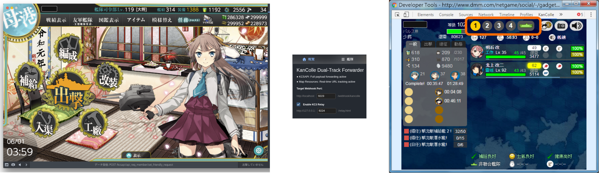
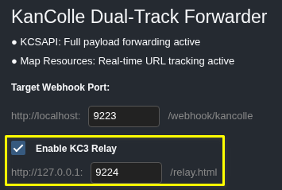
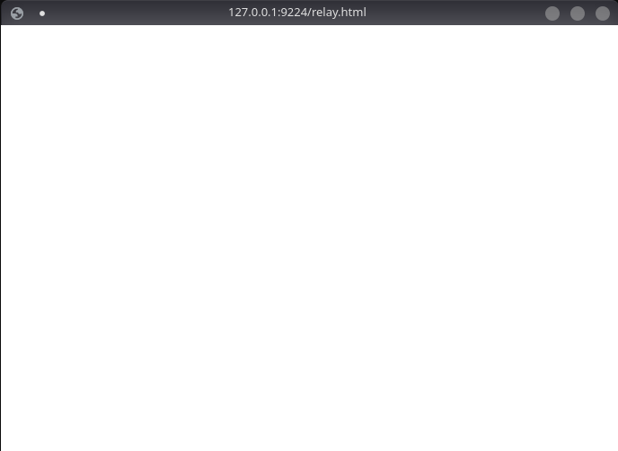

_Ah sh*t, here we go again._

---

## 付録 ‐‐ POI 上で KC3 を使う

結局、やっぱり KC3 の方が POI のプラグイン環境より使いやすいと思うので、  
こうして POI 上で KC3 を使うワークアラウンドを作りました。

仕組みとしては、空っぽの古い Chromium で KC3 を動かし、  
POI の API をクローンして KC3 に渡す、という感じです。



---

### 依存関係

以下をインストールする必要があります：

* poi ブラウザ（そりゃそうだろ）
* `poi-plugin-forwarder`
* V2 マニフェストをまだサポートしている古い Chromium（自分は Version `138.0.7204.183` を使用しています）
* KC3（そりゃそうだろ）

### セットアップ手順

`poi-plugin-forwarder` を開き、  
`KC3 relay` を有効にします。



Chromium に KC3 をインストールしたあと、  
以下のオプションで Chromium を起動してください：

```bash
chromium --app="http://127.0.0.1:9224/relay.html" --auto-open-devtools-for-tabs --disable-background-timer-throttling --disable-renderer-backgrounding --disable-backgrounding-occluded-windows --no-first-run
```

こんな感じの空白画面が出るはずです。



あとは KC3 の F12 パネルを開くだけです。
